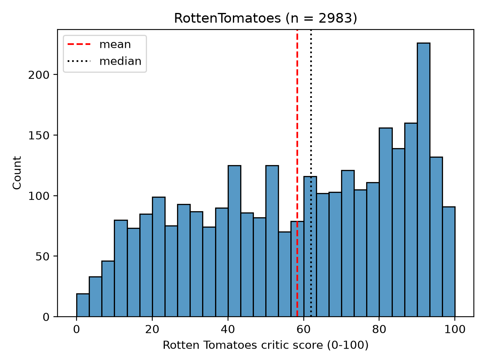
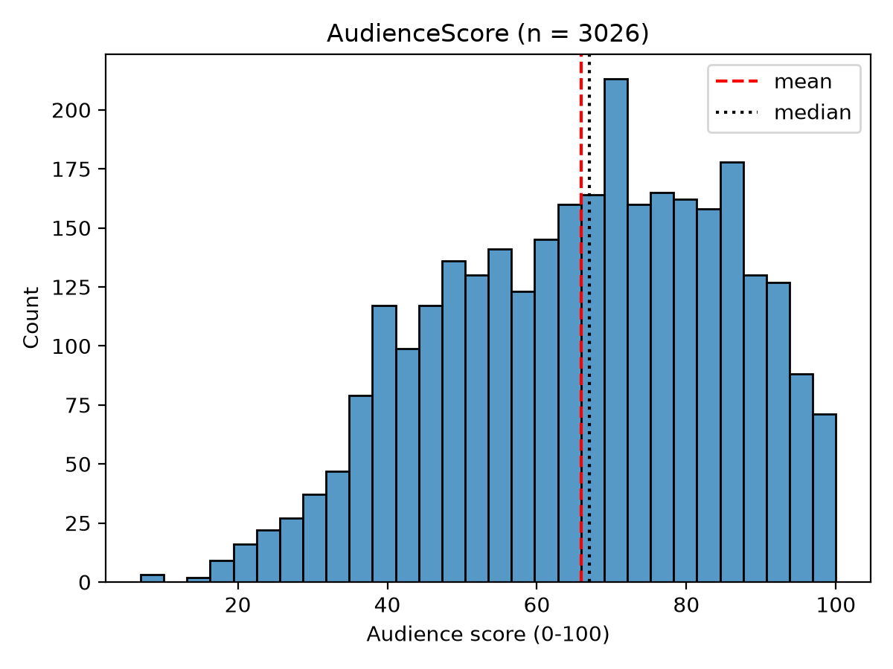
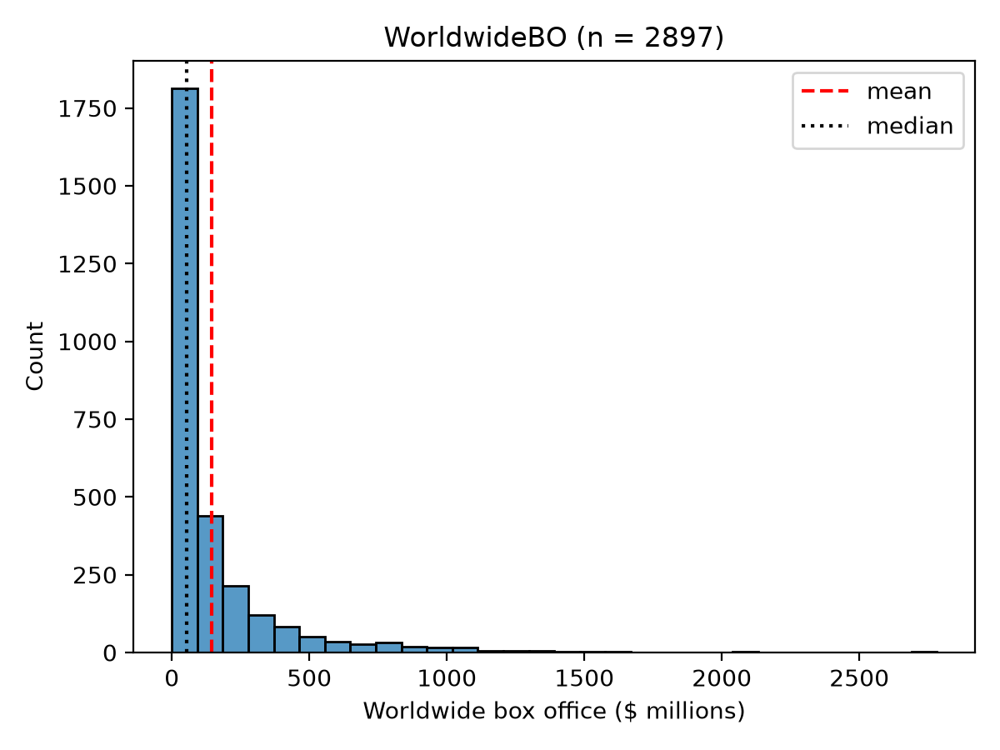
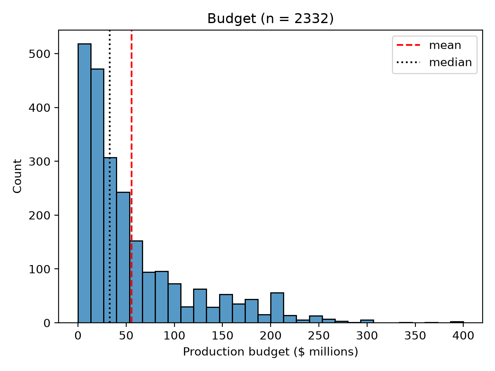

# The Question
Question: How does the rotten tomato's score affect a movies profitability? Audience score?
Specific question: Is there a linear association between a films rotten tomatos score and the profitability of the film? Audience score?

# What Is The Data?
The data was collected by the Lock5, a family of statisticians, for the use in a textbook created by them. They've collected 140 datasets for this textbook. They collected the data from the-numbers.org and the Rotten Tomatos official site. The data can be found here: https://www.lock5stat.com/datapage4e.html
After an initial analysis of the variables, I found that in the most recent form of the dataset, over half of the rows were dropped due to missing budget. Because of this, I decided to append data from earlier versions of the dataset. In this instance, earlier versions contained data of films from a different time period, such as 2007-2011 and 2012-2018. Because the data is still unique, it triples the usable data and likely will not skew results. This results in 3109 rows of data to run analysis on.

# Variables Used
### RottenTomatoes
- Non-Missing : 2983
- Missing : 126
- Mean : 58.35
- Median : 62
- SD : 27.42
- Range : 0 - 100

### AudienceScore
- Non-Missing : 3026
- Missing : 83
- Mean : 65.94
- Median : 67
- SD : 18.85
- Range : 0 - 100

### WorldwideBO (in millions)
- Non-Missing : 2897
- Missing : 212
- Mean : 145.56
- Median : 54.04
- SD : 244.91
- Range : 0.1 - 2781.5

The worldwide box office is heavily skewed right so certain tests will not work as well.
### Budget (in millions)
- Non-Missing : 2332
- Missing : 777
- Impossible : 1
- Mean : 55.59
- Median : 33
- SD : 59.21
- Range : 0.0 - 400

When cleaning the data, all rows with missing or impossible values were dropped, which totaled to 796 rows being dropped. This leaves me with 2313 rows to run analysis on.

### How To Determine Profitability
In the dataset, there is a profit column, but this column is simply determining if the film made back its stated budget. When it comes to the film industry, conventional wisdom states that a film must make back 2.5 times its budget to break even. This is due to theater distribution costs, marketing costs, etc. So to determine if a film is profitable, I will be checking its WorldwideBO against 2.5* the budget. The calculation will provide a number that is either negative or positive (or 0 if it truly broke even). Negative means the film lost that money, while postiive means it profited that money. To account for outliers, a binary variable will also be set on if the film is profitable. This is what will be used in the hypothesis test.

# Hypothesis
Because WorldwideBO is heavily skewed right, a linear-association will not work. To account for this, profitability will be a binary outcome and will be compared against well reviewed and poorly reviewed scores.

**Definitions**
Profitable : Is WorldwideBO >= 2.5*Budget?
Fresh (critics) : Is RottenTomatoes >= 60?
Fresh (audience) : Is AudienceScore >= 60?

### Test 1
Two-Proportion z-test
H_0 : The proportion of profitable films is the same for critic certified-fresh and critic rotten films.
H_0 : p_Fresh - p_Rotten = 0
H_1 : The proportion of profitable films differs for critic certified-fresh and critic rotten films.
H_1 : p_Fresh - p_Rotten != 0

### Test 2
Two-Proportion z-test
H_0 : The proportion of profitable films is the same for audience certified-fresh and audience rotten films.
H_0 : p_Fresh - p_Rotten = 0
H_1 : The proportion of profitable films differs for audience certified-fresh and audience rotten films.
H_1 : p_Fresh - p_Rotten != 0